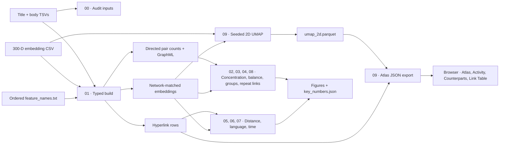
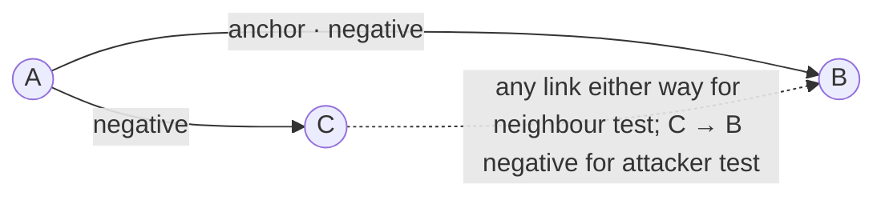
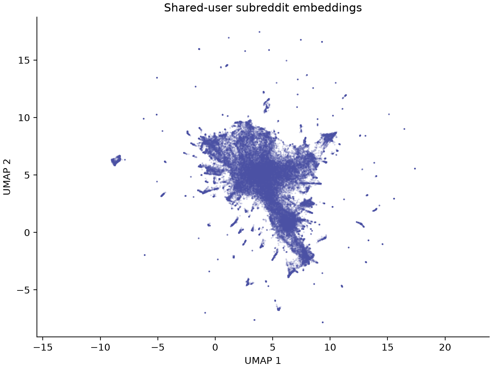

# Network Semantics Project

AIM608 project on signed, directed hyperlinks between Reddit communities.

[Open the public Conflict Atlas demo](https://aim608-conflict-atlas.violet-horse-4096.chatgpt.site)

The project asks where negative-labeled links go, how concentrated they are, and how those patterns relate to community structure, shared audiences, and language. The public demo opens with illustrative hyperlink records. **Load data** reads an exported SNAP file in the browser.

## Data and reported numbers

| Quantity | Value | Provenance |
| --- | ---: | --- |
| Subreddits in the hyperlink network | 55,863 | SNAP dataset summary |
| Hyperlink records | 858,490 | SNAP dataset summary |
| Published coverage | Jan 2014 to Apr 2017 | SNAP dataset summary; the build prints the exact observed UTC bounds |
| Text properties per hyperlink record | 86 | Published property-vector layout |
| Subreddit embedding rows | 51,278 | SNAP download and dataset summary |
| Dimensions per source embedding | 300 | SNAP dataset summary |
| UMAP seed and output dimensions | 42 and 2 | Project configuration |
| Subreddits in the saved UMAP | 51,269 | Measured on the full SNAP embedding CSV |
| Zero-norm vectors omitted | 9 | Measured on the full SNAP embedding CSV |

The source figures above describe the published data. The negative share, duplicate-post overlap, embedding coverage on the hyperlink network, and analysis results are calculated from the actual build outputs. The UMAP-only workflow uses the embeddings CSV independently of the hyperlink TSVs. [SNAP hyperlink data](https://snap.stanford.edu/data/soc-RedditHyperlinks.html) · [SNAP embedding data](https://snap.stanford.edu/data/web-RedditEmbeddings.html)

Each row is a directed hyperlink record. Its label is −1 for negative or +1 for neutral or positive. The same post ID can contribute several rows. Text properties describe the source post; the raw post text is unavailable. Embeddings describe similarity in user participation, and label errors can affect every signed comparison. Subreddit names are dataset identifiers.

## Pipeline



## Run the analyses

After setup, downloads, and completion of the ordered feature list, run from the repository root:

```sh
python src/00_check_data.py
python src/01_build.py
for script in src/0[2-8]_*.py; do python "$script" || break; done
python src/09_export_atlas.py --reuse-projection
```

The final command reuses the checked-in coordinates. Run `python src/09_export_atlas.py` to fit on the current build's matched embedding rows instead. To fit and save the full published embedding set independently:

```sh
python src/09_export_atlas.py --projection-only \
  --raw-embeddings data/raw/web-redditEmbeddings-subreddits.csv
```

Stochastic analyses use seed 42, with seeds 42–46 for Louvain stability. Keep dependency versions fixed when comparing results across machines. Run the pipeline sequentially so each stage can update the shared one-line JSON summary. Undefined statistics are represented as missing values or JSON `null`.

## Figures and statistics index

| Stage | PNG figure | What to read in `results/key_numbers.json` |
| --- | --- | --- |
| 00 Data audit | — | `data_check`: rows, distinct nodes, negative shares, shared post IDs, missing vectors, property-width histogram |
| 01 Build | — | `build`: dates, links, posts, directed pairs, labels, self-loops, and embedding coverage |
| 02 Node statistics | `figures/lorenz_out_links.png` | `node_stats`: Gini, top 0.1% / 1% / 10% shares for outgoing negative, all outgoing, and incoming negative links, and Pearson correlation |
| 03 Balance | `figures/structural_balance.png` | `balance`: triangle sign counts, observed balanced fractions, 1,000-shuffle means and SDs, z-scores, and independent-sign expectations |
| 04 Communities | — | `communities`: component size, modularity and cross-seed stability, silhouette selection, NMI and ARI, within-link shares and null differences |
| 05 Distance | `figures/distance_densities.png` | `distance`: cosine distributions, sample sizes, KS and Cohen's d for each comparison, deduplication and degree-bin checks |
| 06 Language | `figures/language_top_features.png` | `language`: ranked effects and bootstrap intervals, split prevalence, ROC-AUC, PR-AUC and average precision before and after sentiment removal |
| 07 Time | `figures/monthly_negative_links.png` | `time`: calendar coverage, fraction spikes and top sender or pair contributions; monthly rows in `results/monthly_link_stats.parquet` |
| 08 Repeat links | `figures/repeat_negative_pairs.png` | `repeat`: repeat frequency, reciprocity, neighbour and attacker rates, 500-shuffle summaries and z-scores |
| 09 Projection and export | [`figures/embeddings_umap.png`](figures/embeddings_umap.png) | `umap`: fit settings and projected rows; `atlas`: exported nodes, months, and monthly directed pairs |

### How to interpret the network tests



- **Concentration** compares cumulative shares and Gini on the same node population. Negativity can appear concentrated simply because overall linking activity is concentrated.
- **Balance** counts triangles with zero or two negative edges as balanced. The null preserves the unsigned topology and the number of negative signs. The majority and any-negative collapse rules can yield different results.
- **Within versus between** compares endpoint labels inside the largest weak component. The embedding partition covers only nodes with vectors. Report sign gaps in percentage points and check the expected values under shuffling.
- **Distance** uses the original 300-dimensional vectors. The interactive UMAP is for visual exploration, and distances between remote regions can be distorted. Compare negative links with both neutral-or-positive links and random nodes.
- **Language** predicts classifier labels. Closely related language features can retain predictive signal even after sentiment scores are removed. Report prevalence alongside PR performance.
- **Time** ranks increases against the preceding UTC month and prints the denominators. Partial first or last months can affect comparisons.
- **Repeat and neighbour tests** use co-occurrence across the observation period. A departure from the shuffled baseline says which patterns are more or less common; the test contains no chronological evidence of transmission.

## Setup

Use Python 3.11. The checker uses the standard library. The project requirements include python-igraph and the analysis libraries, with PyArrow for Parquet.

```sh
python3.11 -m venv .venv
source .venv/bin/activate
python -m pip install -r requirements.txt
```

Place the two hyperlink TSVs and the headerless subreddit embeddings CSV in `data/raw/`.

- `soc-redditHyperlinks-title.tsv` and `soc-redditHyperlinks-body.tsv` are on the [SNAP Reddit Hyperlink Network page](https://snap.stanford.edu/data/soc-RedditHyperlinks.html).
- `web-redditEmbeddings-subreddits.csv` is on the [SNAP Reddit User and Subreddit Embeddings page](https://snap.stanford.edu/data/web-RedditEmbeddings.html).

The project keeps scripts in `src/`, Parquet intermediates in `data/processed/`, PNG figures in `figures/`, key numbers in `results/`, and demo code in `app/`.

## `src/00_check_data.py`

```sh
python src/00_check_data.py
```

Use `--title`, `--body`, and `--embeddings` to override the raw file paths.

The script counts link rows and distinct source-or-target subreddits by file and across both files. It divides the count of links labeled `-1` by the total number of link rows. Each distinct post ID found in both files counts once toward the overlap, and all link rows remain in the totals. Subreddit matching ignores case and surrounding whitespace. The script counts the number of comma-separated positions in every properties vector and saves the summary in a single line in `results/key_numbers.json` under `data_check`.

For the feature names and their order, read **Data format → POST_PROPERTIES** on SNAP’s Reddit Hyperlink Network page. Copy the names into `feature_names.txt`, one per line in the published order. [SNAP Reddit Hyperlink Network](https://snap.stanford.edu/data/soc-RedditHyperlinks.html)

Missing files, unexpected headers, malformed rows, or unexpected sentiment labels can stop the checker. A width other than 86 is reported, and a vector of the expected width can still contain a bad value or use a different feature order. The embedding check counts fields and names. Missing embeddings limit later similarity analyses. Negative labels are classifier outputs and can be wrong. The checker reports aggregate counts without printing subreddit names.

## `src/01_build.py`

Fill in all 86 lines of `feature_names.txt` in SNAP's published order before running the build. The names must be distinct and cannot match the edge metadata columns. Blank lines and lines beginning with `#` are ignored.

```sh
python src/01_build.py
```

The build accepts `--title`, `--body`, `--embeddings`, and `--feature-names` to override the input paths. It uses seed 42, prints the counts and date range for the data slide, and updates the `build` entry in `results/key_numbers.json`.

| File in `data/processed/` | Contents and design choices |
| --- | --- |
| `edges.parquet` | One record for each raw post–hyperlink row, with `source`, `target`, `post_id`, `timestamp`, `link_sentiment`, `source_file`, and 86 float64 text features. Title rows precede body rows. The build writes chunks to limit memory use. Repeated post IDs and parallel links remain in the data because a post can contribute multiple link records. Quote the distinct post ID count for posts and the row count for links. |
| `pairs.parquet` | One record per ordered `source`, `target` pair. `n_pos` counts labels of +1, which include neutral links, and `n_neg` counts labels of −1. `n_total` includes both. `first_ts` and `last_ts` bound the observed timestamps across both labels. Each direction gets its own row. |
| `embeddings.parquet` | One row per hyperlink node with an available embedding, with `subreddit` and float64 columns `dim_000` through `dim_299` in source order. Names in all three inputs are stripped and lowercased before matching. Embedding-only subreddits are excluded from this table. |
| `graph.graphml` | Directed python-igraph graph. Vertices include every hyperlink subreddit and carry `name` and `has_embedding`. Each ordered pair becomes one edge with its three counts and two timestamps. Vertex names are sorted for stable IDs. GraphML stores timestamps as ISO 8601 strings and may read integral counts back as floats. |

Self-loops stay in the edge table, pair table, graph, and slide totals because they are observed links. The slide output includes their counts so analyses that require distinct endpoints can explicitly filter them. Nodes with no embedding stay in the graph and all edge counts. Embedding comparisons can use only rows whose two endpoints have vectors. The script reports negative rows missing at least one endpoint vector and the subset missing both.

The build treats timezone-free timestamps as UTC and converts explicit offsets to UTC. Bad dates, invalid signs, malformed feature or embedding vectors, and duplicate normalized embedding names fail the build. A correctly sized vector can still be assigned incorrect names if the feature list is out of order. The script stages the processed files before replacing prior outputs. Run the build to completion before starting downstream scripts.

`src/common.py` provides `load_edges()`, `load_pairs()`, `load_embeddings()`, and `load_graph()`. Use `load_edges(columns=[...])` to read only the needed columns. `load_embeddings()` indexes the vectors by normalized subreddit name.

## `src/02_node_stats.py`

```sh
python src/02_node_stats.py
```

Run after `01_build.py`. The script sums each pair's link counts by sender and receiver and saves one row per subreddit to `data/processed/node_stats.parquet`. Incoming-only and outgoing-only subreddits get zero counts in the opposite direction. Each self-loop contributes once to outgoing and once to incoming counts, and parallel links retain their multiplicity. A +1 label includes neutral links. Classifier errors can affect both link counts and rates.

Both rates are published only for subreddits with at least 20 outgoing links. This outgoing activity cutoff limits the effect of very small sending denominators and defines the same eligibility group for both rates. The incoming rate divides negative incoming links by all incoming links and is also missing when there are no incoming links. Eligible subreddits can still have low incoming volume, so use `total_in` when interpreting those rates.

The concentration analysis uses every hyperlink subreddit, including zero-count nodes, for negative outgoing links, all outgoing links, and negative incoming links. Each metric ranks subreddits separately. The top 0.1%, 1%, and 10% groups round up to a whole subreddit. The Lorenz curves accumulate counts from the lowest-count subreddit upward, and the Gini measures the area between each curve and equality. Pearson correlation uses the paired raw negative outgoing and incoming counts across all nodes.

The script overlays the two outgoing Lorenz curves in `figures/lorenz_out_links.png`. It prints the Ginis, top-group shares, correlation, rate eligibility counts, and whether the top 10% send a majority of negative links. The same numeric results are saved under `node_stats` in `results/key_numbers.json`. A metric with zero total links has undefined concentration, and Pearson correlation is undefined if either count is constant. Rebuild the pair table first if the raw inputs have changed.

## `src/03_balance.py`

```sh
python src/03_balance.py
```

Run after `01_build.py`. The script removes self-loops, combines the link counts of both directions for each pair, and uses python-igraph to enumerate triangles of three distinct subreddits. The main rule marks a pair negative if it has any negative link. The robustness rule marks it negative only if negative links outnumber neutral-or-positive links. Ties receive the nonnegative sign so both rules use the same topology.

A triangle is balanced under this definition when it has zero or two negative edges. For each rule, 1,000 seeded shuffles redistribute the signs among existing edges while keeping the number of negative edges fixed. The script prints the observed triangle counts, shuffle means, sample standard deviations, and z-scores for all four types. It also compares the balanced fraction with the shuffle distribution and reports an independent-sign expectation using the observed negative-edge fraction and the binomial formula.

The chart in `figures/structural_balance.png` shows both rules, with error bars of one shuffle standard deviation. Numbers are saved under `balance` in `results/key_numbers.json`. A graph without triangles has no balanced fraction, and a shuffle count with zero variance has no z-score. The any-negative rule gives more active pairs more chances to receive a negative label. The shuffle preserves topology and overall sign frequency but can change each node's negative degree. Label errors and node-level clustering can therefore affect the comparison.

## `src/04_communities.py`

Run `python src/04_communities.py` after the build. The script keeps the largest weak component and reports the number of dropped nodes. Louvain uses an undirected, unsigned, unweighted graph with one edge per unordered pair and no self-loops. It runs five seeds starting at 42, reports modularity for each run, and keeps the highest-scoring partition. Ties favor the earliest seed. Pairwise adjusted Rand index (ARI) measures agreement among the runs, regardless of how they number communities.

K-means uses the original embedding coordinates with Euclidean distance. It tests k from 2 through 12, bounded by the number of available vectors, and selects the highest silhouette score on a fixed sample of up to 3,000 nodes. Each candidate is fitted on all matched vectors. Ties favor smaller k. NMI and ARI compare the resulting partitions only for nodes with both labels. The file `data/processed/communities.parquet` contains one row per retained node, with a structural community ID and a nullable embedding cluster ID.

A link is within a group when its endpoint IDs match, and between groups when they differ. The comparison uses directed hyperlink records with their original multiplicity and excludes self-loops, which would always count as within. A +1 label includes neutral links. The embedding analysis requires both endpoints to have cluster IDs, so its eligible link set can differ from the structural set. Within each set, 1,000 fixed-count sign shuffles preserve the endpoints and the original sign totals. A hypergeometric draw gives exactly the shuffle distribution of the number of negative links that land within groups, without expanding the pair counts back into individual rows. The script reports observed and null within shares and the percentage-point difference between the sign groups.

Small or degenerate embedding sets can leave silhouette and the embedding partition undefined. Similarity between partitions can be low because linkage and embedding proximity capture different relationships. Missing vectors can change which links the embedding analysis covers. Signs are classifier labels, and the shuffle leaves overall counts fixed while allowing each subreddit's negative-link count to change. Key numbers are printed and saved under `communities` in `results/key_numbers.json`.

## `src/05_distance.py`

Run `python src/05_distance.py` after the build. Cosine is the dot product after dividing each vector by its length. The script computes it once per unordered endpoint pair and writes the result for every covered hyperlink row to `data/processed/edge_similarities.parquet`. This file includes post ID, input file, direction, label, and source degree. Rows with missing or zero-length vectors have undefined cosine and are omitted. Covered self-links remain in the observed groups and have cosine 1.

The baseline draws 100,000 ordered pairs of distinct nodes uniformly from the usable vectors in the built embeddings table. Draws are independent, so a pair can recur. The robustness pass retains only the earliest link per directed pair and uses that link’s label. Timestamps that tie use build row order. This gives each pair one vote and makes the check sensitive to the earliest observed label on mixed-sign pairs. A +1 label includes neutral links.

The size analysis uses the sender's number of distinct neighbors as a network proxy for size. It counts neighbors across the full graph in either direction, excluding self-links. Both passes report results in degree bins 0–9, 10–99, 100–999, and 1000+, using the same source bin for random pairs. The random destination can have any degree. Sparse bins can yield undefined or unstable comparisons, and graph degree may differ substantially from subscriber count.

The script prints group sizes, means, medians, sample standard deviations, pairwise KS statistics, and signed Cohen's d with pooled sample standard deviations. The KS statistic describes the maximum gap between the empirical cumulative distributions. Links can share nodes, so the script reports descriptive statistics without independence-based p-values. Cohen's d is undefined when either group has fewer than two observations or the pooled variance is zero. Two panels in `figures/distance_densities.png` overlay the three normalized histograms before and after deduplication, and the numbers are stored under `distance` in `results/key_numbers.json`. The embedding proximity reflects shared user participation, and sign counts inherit classifier errors.

## `src/06_language.py`

Run `python src/06_language.py` after the build. Use the same `feature_names.txt` as the build, or pass its path with `--feature-names`. The script compares text properties on hyperlink rows with negative labels and rows with neutral-or-positive labels. It uses the difference in means divided by the pooled sample standard deviation. A positive effect means the property is higher on negative-labeled rows. It ranks all 86 features by absolute effect and prints plain-language explanations for the top 15 using the published SNAP order. [SNAP Reddit Hyperlink Network, POST_PROPERTIES](https://snap.stanford.edu/data/soc-RedditHyperlinks.html)

For those 15 features, 500 bootstrap draws resample distinct post IDs with replacement and carry every row for a sampled post into the draw. The 95% percentile intervals account for repeated rows from the same post. They are descriptive intervals for selected features and do not account for ranking or dependence within subreddits. A feature with zero pooled variance has an undefined effect, and a bootstrap draw with too few rows in a class yields no estimate.

The model comparison uses the same approximately stratified holdout for all fits, grouping by post ID to keep copies of a post on one side of the split. It fits scaled logistic regression and histogram gradient boosting. It reports ROC-AUC, trapezoidal PR-AUC, and average precision, with the held-out negative prevalence as the average-precision baseline. For each model it permutes features five times on a fixed, stratified sample of up to 3,000 holdout rows and reports the resulting drop in average precision. When features are correlated, permuting one can understate their joint contribution.

The robustness run refits both models after removing the three VADER scores and the six LIWC features for affect, positive emotion, negative emotion, anxiety, anger, and sadness. It reports how much performance changes and how the remaining average precision compares with prevalence. Predictive performance measures agreement with the published classifier labels. Other language features can still proxy for sentiment, and this split does not measure generalization to unseen subreddits or time periods.

Outputs are `data/processed/language_effects.parquet`, `data/processed/language_importances.parquet`, and `figures/language_top_features.png`. The script prints key numbers and saves them under `language` in `results/key_numbers.json`.

## `src/07_time.py`

Run `python src/07_time.py` after the build. The script groups hyperlink rows by UTC calendar month. It plots negative counts, negative fractions, distinct negative senders, and the share of negative links sent by each month's top 10 senders. Months with no links have undefined negative fractions, and months with no negative links have undefined top-10 shares. The analysis is deterministic and uses no randomness.

A spike is one of the three largest positive percentage-point changes in negative fraction from the immediately previous calendar month. Both months must have links. The first and last observed months are flagged because coverage may be partial. A large percentage-point increase can occur in a low-volume month, so the report prints both months' denominators.

For each spike, the script ranks senders and directed pairs by negative-link count and separately by contribution to the rise. A group's contribution is its negative links divided by all links this month minus the corresponding share last month. These signed contributions sum to the overall change, and they can shift when the denominator changes even if the group sends the same number of negative links. The report prints names as dataset identifiers, along with concentration shares and the number of groups that contributed to the rise. Classifier errors can affect all of these counts.

The table is saved to `results/monthly_link_stats.parquet`, spike details to `results/key_numbers.json` under `time`, and the figure to `figures/monthly_negative_links.png`.

## `src/08_repeat.py`

Run `python src/08_repeat.py` after the build. The script keeps parallel hyperlinks aggregated in the directed pair table and excludes self-loops. It plots the frequency of each observed negative-link count among negative pairs on log–log axes, reports how many of those pairs have at least two negative links, and computes reciprocity as the fraction of negative directed pairs with a negative reverse pair. A reciprocal dyad contributes both directions to that fraction.

For every negative A→B pair, the neighbour test looks for at least one third subreddit C with a negative A→C link and any observed link between B and C. The attacker variant requires C→B to be negative. The code enumerates the undirected triangles once using igraph and retains orientations that can satisfy these conditions. A link-weighted rate gives each pair its number of negative links as weight. A pair-weighted rate gives every negative pair one vote. Multiple qualifying neighbours count as one hit on the anchor pair.

The 500 seeded shuffles reassign signs over hyperlink slots and sum them back into their original pairs, preserving direction, pair multiplicities, and the network-wide number of negative labels. The script recalculates which pairs are negative and which neighbours send negative links to B after each shuffle. It reports null means, sample standard deviations, percentage-point differences, and z-scores. A rate with no negative pairs or a z-score with zero null variance is undefined. The shuffle can change each node's negative degree, so concentration around individual senders can affect the result. The test measures co-occurrence and uses no event chronology.

The figure is saved to `figures/repeat_negative_pairs.png` and the frequency distribution and comparisons to `results/key_numbers.json` under `repeat`.

## Conflict Atlas demo

From the project folder, serve the buildless app with `python -m http.server 8765 --bind 127.0.0.1 --directory app/dist` and open `http://127.0.0.1:8765`. The app starts with fictional communities and an **Illustrative data** badge. Search for a community, filter arrows by direction, and select a counterpart to inspect counts and negative fractions in both directions. Use the timeline brush, date presets, or month menus to narrow the period. The left sidebar shows dataset node count, negative links in the selected period, and the active dates. Activity lists monthly directional totals and rates. Top Counterparts ranks negative-labeled links, and Link Table shows paginated monthly counts per directed pair.

After running the real build, run `python src/09_export_atlas.py --reuse-projection` and select `data/processed/atlas_data.json` with **Load data**. The file is read in the browser. The exporter groups original link rows by UTC month and directed pair, retaining both negative counts and total counts. Missing embeddings leave communities without map positions, but those communities still have timelines and links.

## `src/09_export_atlas.py`

The [precomputed coordinate table](data/processed/umap_2d.parquet) contains `subreddit`, `umap_x`, and `umap_y`. It contains 51,269 of SNAP's 51,278 embedding rows. The nine zero-norm vectors have undefined cosine distance and were skipped. The fit sorts names and uses cosine distance, seed 42, 15 neighbours, minimum distance 0.1, and one worker. The browser reads coordinates from the exported JSON, so filtering dates or selecting subreddits does not refit the map. [UMAP reproducibility documentation](https://umap-learn.readthedocs.io/en/latest/reproducibility.html)



The UMAP figure and coordinates are included here. The other figures and statistics in the index are generated by their scripts once the hyperlink TSVs and populated feature list are available.

The Atlas distinguishes illustrative and SNAP exports. Its left rail shows dataset size and in-range negative links. Its right rail reports counts for the selected node and a pair-level breakdown with all-link denominators. The timeline and Activity calculate monthly directional counts, and date controls also filter Top Counterparts and the paginated Link Table.

### References

- Srijan Kumar, William L. Hamilton, Jure Leskovec, and Dan Jurafsky. *Community Interaction and Conflict on the Web*. WWW 2018. [Paper and dataset citation](https://snap.stanford.edu/data/soc-RedditHyperlinks.html)
- Jure Leskovec, Daniel Huttenlocher, and Jon Kleinberg. *Signed Networks in Social Media*. CHI 2010.
- David Easley and Jon Kleinberg. *Networks, Crowds, and Markets*, chapter 5, “Positive and Negative Relationships.”
